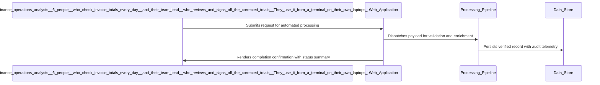

# Architecture Diagram

| Field | Value |
| --- | --- |
| Project / Pipeline | E01-calculator |
| Artifact version | 1 |
| Generated | 2026-10-09 09:38:52Z |
| Document status | Current at generation time |
| Classification | Internal project delivery artifact |
| Review posture | Draft until reviewed and accepted by accountable project roles |

> This artifact is generated from captured Pravetra project data. Empty sections are intentionally marked instead of inferred.

---

## 1. Executive Summary

| Metric | Value |
| --- | --- |
| Component tables | 1 |
| Requirement structure tables | 1 |
| Sequence diagrams | 10 |
| Requirements without sequence diagrams | 13 |

## 2. Components

| Technology Decision | Rationale | External System | Integration Consideration | Selected Option | Rejected Alternatives |
| --- | --- | --- | --- | --- | --- |
| C# on .NET 10 as a console application, tested with xUnit vs Python 3 script tested with pytest (the team knows .NET; a Python runtime would have to be installed on analyst laptops) vs F# on .NET 10 (no team experience) | Implementation language and test framework. The team already knows C# and .NET, and System.Decimal avoids the binary floating-point errors that are the core problem. The owner mandates .NET for the showcase. | No | N/A | C# on .NET 10 as a console application, tested with xUnit | Python 3 script tested with pytest (the team knows .NET; a Python runtime would have to be installed on analyst laptops); F# on .NET 10 (no team experience) |
| an embedded SQLite database file accessed with Microsoft.Data.Sqlite vs a JSON file rewritten after every calculation (no transactions; a crash mid-write corrupts the history) vs a plain-text file with one line per calculation (same weakness, and no way to enforce the last-10 rule atomically) | Storage for the calculation history. SQLite is the mandated database. It gives transactional writes, survives a crash mid-write, needs no server and is one file to back up or delete. | No | N/A | an embedded SQLite database file accessed with Microsoft.Data.Sqlite | a JSON file rewritten after every calculation (no transactions; a crash mid-write corrupts the history); a plain-text file with one line per calculation (same weakness, and no way to enforce the last-10 rule atomically) |
| System.Decimal for arithmetic operations vs double for arithmetic operations | System.Decimal is the preferred choice for this project due to its ability to handle financial calculations accurately. The requirement for precise arithmetic evaluation (R10) and the need to avoid floating-point inaccuracies make System.Decimal the only viable option. Switching to double would compromise the integrity of the calculations, which is unacceptable given the project's goals. | No | N/A | System.Decimal for arithmetic operations | double for arithmetic operations |
| Console.ReadLine for user input vs Command-line arguments for user input | Both input methods are viable, but Console.ReadLine is preferred for its simplicity and direct interaction with users. Command-line arguments can be considered for advanced use cases where batch processing is needed. | No | N/A | Console.ReadLine for user input | Command-line arguments for user input |
| Decimal rounding for results vs String formatting for output | Decimal rounding is essential for financial accuracy, while string formatting enhances user experience. Both should be implemented to ensure the calculator meets its functional requirements. | No | N/A | Decimal rounding for results | String formatting for output |
| Console.Error for error messages vs Throwing exceptions for error handling | Both options provide mechanisms for handling errors gracefully, but using Console.Error aligns with the requirement for clear user feedback without crashing the application. | No | N/A | Console.Error for error messages | Throwing exceptions for error handling |

## 3. Requirement Structure

| # | Kind | Priority | Parent | Statement | Acceptance criteria |
| --- | --- | --- | --- | --- | --- |
| 1 | business | Must | realizes project | Reduce the error rate in invoice total calculations from approximately 5% to under 0.5% by implementing a command-line calculator. | 1 |
| 2 | business | Must | realizes project | Minimize rework time associated with incorrect invoice totals from roughly 30 minutes per error to near zero. | 1 |
| 3 | functional | Must | #1 | The calculator shall evaluate arithmetic expressions with proper operator precedence, ensuring that expressions like '100 - 10% + 5' return accurate results. | 2 |
| 4 | functional | Must | #1 | The calculator shall handle rounding using decimal arithmetic to avoid floating-point inaccuracies. | 2 |
| 5 | functional | Must | #1 | The calculator shall provide clear error messages for malformed expressions, preventing crashes and ensuring user understanding. | 2 |
| 6 | functional | Must | #1 | The calculator shall maintain a local SQLite database to store the last 10 calculations, allowing users to access their calculation history. | 2 |
| 7 | functional | Must | #1 | The calculator shall run locally on each analyst's laptop without requiring network access or external services. | 2 |
| 8 | nonfunctional | Must | constrains project | The calculator shall evaluate arithmetic expressions quickly enough for interactive use on an analyst's laptop. | 1 |
| 9 | nonfunctional | Must | constrains project | The calculator shall be available to analysts whenever they work, because it runs locally on their laptop and needs no network or external service. | 1 |
| 10 | nonfunctional | Must | constrains project | The calculator shall use decimal arithmetic for all calculations to ensure accuracy in financial computations. | 1 |
| 11 | nonfunctional | Should | constrains project | The calculator shall provide audit logging of all calculations performed, including timestamps and user identifiers, stored in the SQLite database. | 1 |
| 12 | functional | Must | #1 | The calculator shall allow users to input arithmetic expressions directly into the terminal interface. | 2 |
| 13 | functional | Should | #1 | The calculator shall provide built-in help documentation accessible from the terminal. | 2 |
| 14 | nonfunctional | Must | constrains project | The calculator shall ensure data retention by maintaining the last 10 calculations in the SQLite database. | 1 |
| 15 | business | Should | realizes project | Ensure that the command-line calculator is user-friendly and requires minimal training for the finance operations analysts. | 1 |
| 16 | functional | Could | #1 | The calculator shall provide a mechanism for users to delete their calculation history from the SQLite database. | 2 |
| 17 | nonfunctional | Should | constrains project | The calculator shall be maintainable with a low operational cost, requiring no more than half an engineer-day per quarter for updates and fixes. | 1 |
| 18 | business | Must | realizes project | Ensure the command-line calculator is compatible with Windows, macOS, and Linux operating systems. | 1 |
| 19 | functional | Should | #1 | The calculator shall provide a mechanism for users to view their calculation history from the SQLite database. | 2 |
| 20 | nonfunctional | Must | constrains project | The calculator shall ensure compliance with internal data handling policies, given that no sensitive data is processed. | 1 |
| 21 | business | Must | realizes project | Ensure the command-line calculator provides accurate results for various arithmetic operations, including addition, subtraction, multiplication, and division. | 1 |
| 22 | functional | Must | #1 | The calculator shall accurately evaluate division operations, including handling division by zero gracefully. | 2 |
| 23 | nonfunctional | Should | constrains project | The calculator shall ensure that all arithmetic operations are performed with a precision of at least 2 decimal places. | 1 |

## 4. Sequence - The calculator shall evaluate arithmetic expressions with proper operator precedence, ensuring that expressions like '100 - 10% + 5' return accurate results.

## 5. Sequence - The calculator shall handle rounding using decimal arithmetic to avoid floating-point inaccuracies.

## 6. Sequence - The calculator shall provide clear error messages for malformed expressions, preventing crashes and ensuring user understanding.

## 7. Sequence - The calculator shall maintain a local SQLite database to store the last 10 calculations, allowing users to access their calculation history.

## 8. Sequence - The calculator shall run locally on each analyst's laptop without requiring network access or external services.

## 9. Sequence - The calculator shall allow users to input arithmetic expressions directly into the terminal interface.

## 10. Sequence - The calculator shall provide built-in help documentation accessible from the terminal.

## 11. Sequence - The calculator shall provide a mechanism for users to delete their calculation history from the SQLite database.

## 12. Sequence - The calculator shall provide a mechanism for users to view their calculation history from the SQLite database.

## 13. Sequence - The calculator shall accurately evaluate division operations, including handling division by zero gracefully.

## 14. Requirements Without a Sequence Diagram

- Reduce the error rate in invoice total calculations from approximately 5% to under 0.5% by implementing a command-line calculator. (No interaction steps)
- Minimize rework time associated with incorrect invoice totals from roughly 30 minutes per error to near zero. (No interaction steps)
- The calculator shall evaluate arithmetic expressions quickly enough for interactive use on an analyst's laptop. (No interaction steps)
- The calculator shall be available to analysts whenever they work, because it runs locally on their laptop and needs no network or external service. (No interaction steps)
- The calculator shall use decimal arithmetic for all calculations to ensure accuracy in financial computations. (No interaction steps)
- The calculator shall provide audit logging of all calculations performed, including timestamps and user identifiers, stored in the SQLite database. (No interaction steps)
- The calculator shall ensure data retention by maintaining the last 10 calculations in the SQLite database. (No interaction steps)
- Ensure that the command-line calculator is user-friendly and requires minimal training for the finance operations analysts. (No interaction steps)
- The calculator shall be maintainable with a low operational cost, requiring no more than half an engineer-day per quarter for updates and fixes. (No interaction steps)
- Ensure the command-line calculator is compatible with Windows, macOS, and Linux operating systems. (No interaction steps)
- The calculator shall ensure compliance with internal data handling policies, given that no sensitive data is processed. (No interaction steps)
- Ensure the command-line calculator provides accurate results for various arithmetic operations, including addition, subtraction, multiplication, and division. (No interaction steps)
- The calculator shall ensure that all arithmetic operations are performed with a precision of at least 2 decimal places. (No interaction steps)

