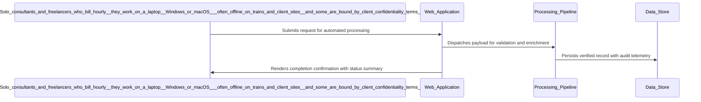

# Architecture Diagram

| Field | Value |
| --- | --- |
| Project / Pipeline | E03-focus-ledger |
| Artifact version | 1 |
| Generated | 2026-10-09 11:34:13Z |
| Document status | Current at generation time |
| Classification | Internal project delivery artifact |
| Review posture | Draft until reviewed and accepted by accountable project roles |

> This artifact is generated from captured Pravetra project data. Empty sections are intentionally marked instead of inferred.

---

## 1. Executive Summary

| Metric | Value |
| --- | --- |
| Component tables | 1 |
| Requirement structure tables | 1 |
| Sequence diagrams | 10 |
| Requirements without sequence diagrams | 11 |

## 2. Components

| Technology Decision | Rationale | External System | Integration Consideration | Selected Option | Rejected Alternatives |
| --- | --- | --- | --- | --- | --- |
| C# on .NET 10 with the Avalonia UI desktop toolkit vs WPF (Windows only, so it cannot run on the owner's Mac) vs .NET MAUI (no Linux support and weaker desktop support than Avalonia) vs WinForms (Windows only) vs A local web page or an Electron shell (not .NET, and a local port is a network surface the no-network promise forbids) vs Python with a Qt or Tkinter toolkit (rejected: the owner mandates .NET for all three examples) | Application language and desktop UI toolkit. The owner mandates .NET. Avalonia UI gives a real native window, a system tray icon and a timer on Windows, macOS and Linux from one codebase, which matches the owner's Mac and the Windows target; the tray timer requires a tray icon. The app is published as a single-file, self-contained executable per platform (dotnet publish) and tested with xUnit. | No | N/A | C# on .NET 10 with the Avalonia UI desktop toolkit | WPF (Windows only, so it cannot run on the owner's Mac); .NET MAUI (no Linux support and weaker desktop support than Avalonia); WinForms (Windows only); A local web page or an Electron shell (not .NET, and a local port is a network surface the no-network promise forbids); Python with a Qt or Tkinter toolkit (rejected: the owner mandates .NET for all three examples) |
| an embedded SQLite database file, one per user, on the user machine, accessed through Microsoft.Data.Sqlite vs plain JSON or CSV files in a user folder (no transactions, so a crash mid-write corrupts the ledger) | Database. SQLite is the mandated database. It is a single file with no server process, so the product keeps its local-first, no-server promise and a backup is a file copy. | No | N/A | an embedded SQLite database file, one per user, on the user machine, accessed through Microsoft.Data.Sqlite | plain JSON or CSV files in a user folder (no transactions, so a crash mid-write corrupts the ledger) |
| CSV export vs PDF export | The choice between CSV and PDF export depends on user needs for data presentation. CSV is favored for its simplicity, while PDF is preferred for formal documentation. | No | N/A | CSV export | PDF export |

## 3. Requirement Structure

| # | Kind | Priority | Parent | Statement | Acceptance criteria |
| --- | --- | --- | --- | --- | --- |
| 1 | business | Must | realizes project | Enable independent consultants and freelance developers to accurately track their billable hours, reducing under-billing by at least 4 hours per week, which translates to approximately $15,000 annually per consultant. | 1 |
| 2 | business | Must | realizes project | Provide users with a trustworthy weekly timesheet that can be generated in under 2 minutes. | 1 |
| 3 | functional | Must | #1 | The application must allow users to start a focus session by selecting a client and entering a one-line task description. | 2 |
| 4 | functional | Must | #1 | The application must display a timer in the system tray that counts the duration of the focus session. | 2 |
| 5 | functional | Must | #1 | The application must prompt the user after 90 minutes of inactivity to confirm whether to continue the session or trim it. | 2 |
| 6 | functional | Must | #1 | The application must store all session data, including client names, task descriptions, start and end times, and user notes, in an encrypted local SQLite database. | 2 |
| 7 | functional | Must | #1 | The application must provide a weekly review screen that totals sessions by client and task type. | 2 |
| 8 | functional | Must | #1 | The application must allow users to export their timesheet as a CSV or PDF file. | 2 |
| 9 | nonfunctional | Must | constrains project | The application must ensure that the timer updates in real-time with a maximum latency of 1 second. | 1 |
| 10 | nonfunctional | Must | constrains project | The application must start and record focus sessions without a network connection, so the timer is available whenever the user's computer is on. | 1 |
| 11 | nonfunctional | Must | constrains project | The application must encrypt all stored data at rest using AES-256 encryption to protect sensitive client information. | 1 |
| 12 | nonfunctional | Should | constrains project | The application must allow users to access their historical session data for as long as they keep it. | 1 |
| 13 | nonfunctional | Must | constrains project | The application must provide a backup and recovery mechanism that allows users to restore their session data from an encrypted local backup file. | 1 |
| 14 | nonfunctional | Must | constrains project | The application must comply with GDPR regulations, allowing users to delete their data upon request. | 1 |
| 15 | nonfunctional | Should | constrains project | The application must have a user interface that adheres to accessibility standards, ensuring usability for all users. | 1 |
| 16 | functional | Must | #1 | The application must allow users to manually stop a focus session and record the end time. | 2 |
| 17 | functional | Should | #1 | The application must notify users of any unsaved session data when they attempt to close the application. | 2 |
| 18 | nonfunctional | Should | constrains project | The application must ensure that the user interface is responsive, with a maximum load time of 2 seconds for any screen. | 1 |
| 19 | functional | Must | #1 | The application must allow users to view a history of their past focus sessions, including client names, task descriptions, and duration. | 2 |
| 20 | functional | Should | #1 | The application must provide a mechanism for users to edit or delete past focus sessions. | 2 |
| 21 | nonfunctional | Must | constrains project | The application must ensure that session data is backed up at least once a week to prevent data loss. | 1 |

## 4. Sequence - The application must allow users to start a focus session by selecting a client and entering a one-line task description.

## 5. Sequence - The application must display a timer in the system tray that counts the duration of the focus session.

## 6. Sequence - The application must prompt the user after 90 minutes of inactivity to confirm whether to continue the session or trim it.

## 7. Sequence - The application must store all session data, including client names, task descriptions, start and end times, and user notes, in an encrypted local SQLite database.

## 8. Sequence - The application must provide a weekly review screen that totals sessions by client and task type.

## 9. Sequence - The application must allow users to export their timesheet as a CSV or PDF file.

## 10. Sequence - The application must allow users to manually stop a focus session and record the end time.

## 11. Sequence - The application must notify users of any unsaved session data when they attempt to close the application.

## 12. Sequence - The application must allow users to view a history of their past focus sessions, including client names, task descriptions, and duration.

## 13. Sequence - The application must provide a mechanism for users to edit or delete past focus sessions.

## 14. Requirements Without a Sequence Diagram

- Enable independent consultants and freelance developers to accurately track their billable hours, reducing under-billing by at least 4 hours per week, which translates to approximately $15,000 annually per consultant. (No interaction steps)
- Provide users with a trustworthy weekly timesheet that can be generated in under 2 minutes. (No interaction steps)
- The application must ensure that the timer updates in real-time with a maximum latency of 1 second. (No interaction steps)
- The application must start and record focus sessions without a network connection, so the timer is available whenever the user's computer is on. (No interaction steps)
- The application must encrypt all stored data at rest using AES-256 encryption to protect sensitive client information. (No interaction steps)
- The application must allow users to access their historical session data for as long as they keep it. (No interaction steps)
- The application must provide a backup and recovery mechanism that allows users to restore their session data from an encrypted local backup file. (No interaction steps)
- The application must comply with GDPR regulations, allowing users to delete their data upon request. (No interaction steps)
- The application must have a user interface that adheres to accessibility standards, ensuring usability for all users. (No interaction steps)
- The application must ensure that the user interface is responsive, with a maximum load time of 2 seconds for any screen. (No interaction steps)
- The application must ensure that session data is backed up at least once a week to prevent data loss. (No interaction steps)

