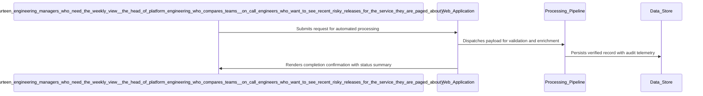

# Architecture Diagram

| Field | Value |
| --- | --- |
| Project / Pipeline | E02-release-pulse |
| Artifact version | 1 |
| Generated | 2026-10-09 10:53:23Z |
| Document status | Current at generation time |
| Classification | Internal project delivery artifact |
| Review posture | Draft until reviewed and accepted by accountable project roles |

> This artifact is generated from captured Pravetra project data. Empty sections are intentionally marked instead of inferred.

---

## 1. Executive Summary

| Metric | Value |
| --- | --- |
| Component tables | 1 |
| Requirement structure tables | 1 |
| Sequence diagrams | 9 |
| Requirements without sequence diagrams | 10 |

## 2. Components

| Technology Decision | Rationale | External System | Integration Consideration | Selected Option | Rejected Alternatives |
| --- | --- | --- | --- | --- | --- |
| C# on .NET: an ASP.NET Core API that also hosts the three background workers (ingest, scoring, digest) as hosted background services in one process vs Python workers beside a .NET API (a second runtime to build, deploy and monitor) vs Three separate .NET worker processes (three deployments for one small team group) | Server language, framework and hosting model. The owner mandates .NET. One process keeps deployment to a single published build, and hosted services give the workers a lifetime tied to the API host without a second runtime. | No | N/A | C# on .NET: an ASP.NET Core API that also hosts the three background workers (ingest, scoring, digest) as hosted background services in one process | Python workers beside a .NET API (a second runtime to build, deploy and monitor); Three separate .NET worker processes (three deployments for one small team group) |
| a SQLite-backed job table polled by the hosted background services vs an in-process channel (System.Threading.Channels) inside the API host (events queued in memory are lost when the host restarts) vs a spool folder of JSON files read by the workers (no transactions; a crash can lose or double-process an event) | Database and background-work queue. SQLite is the mandated database. A job table written in the same transaction as the event makes the at-least-once, scored-once requirement testable, with no broker to run. Write-ahead mode lets the API read while a worker writes. | No | N/A | a SQLite-backed job table polled by the hosted background services | an in-process channel (System.Threading.Channels) inside the API host (events queued in memory are lost when the host restarts); a spool folder of JSON files read by the workers (no transactions; a crash can lose or double-process an event) |
| ASP.NET Core Web API with SignalR vs ASP.NET Core Web API with polling mechanism | The choice between SignalR and polling hinges on the need for real-time updates versus simplicity. SignalR offers a more responsive user experience, which aligns with the requirement for timely insights, but comes with added complexity. Polling is easier to implement but may not meet the latency requirements effectively. | No | N/A | ASP.NET Core Web API with polling mechanism | ASP.NET Core Web API with SignalR |

## 3. Requirement Structure

| # | Kind | Priority | Parent | Statement | Acceptance criteria |
| --- | --- | --- | --- | --- | --- |
| 1 | business | Must | realizes project | Provide a consistent, trustworthy weekly release-health view for all 14 engineering managers, reducing the manual assembly time from 90 minutes to under one minute by automating data aggregation. | 1 |
| 2 | business | Must | realizes project | Surface repeated risky release patterns before they escalate into incidents, ensuring that all managers are aware of potential issues in a timely manner. | 1 |
| 3 | functional | Must | #1 | Integrate with the CI system to receive deploy events in real-time via webhooks, capturing service name, timestamp, outcome, and change ticket ID for each deploy. | 2 |
| 4 | functional | Must | #1 | Integrate with the incident tracking tool to receive incident events in real-time via webhooks, capturing service name, timestamp, severity, and other relevant details. | 2 |
| 5 | functional | Must | #1 | Normalize incoming deploy and incident data to ensure consistency across all teams, applying defined rules for scoring release health. | 2 |
| 6 | functional | Must | #1 | Calculate a release-health score based on defined rules, updating the score in real-time as new deploy and incident data is ingested. | 2 |
| 7 | functional | Must | #1 | Compile a summary of release health for each team and email it to all engineering managers every Monday morning, ensuring timely delivery of insights. | 2 |
| 8 | functional | Should | #1 | Provide a user interface that allows engineering managers to view the release health summary and drill down into specific incidents and deploy events. | 2 |
| 9 | nonfunctional | Must | constrains project | Ensure the application is available during working hours, with monitoring in place to detect and alert on any downtime. | 1 |
| 10 | nonfunctional | Must | constrains project | Process incoming webhook events with a latency of no more than 2 seconds for 95% of events, ensuring timely updates to release health scores. | 1 |
| 11 | nonfunctional | Must | constrains project | Implement data encryption in transit and at rest to protect sensitive incident data, ensuring compliance with internal security policies. | 1 |
| 12 | nonfunctional | Must | constrains project | Maintain an audit log of all actions taken within the application, including data ingestion, scoring calculations, and user access, retaining logs for a minimum of 24 months. | 1 |
| 13 | nonfunctional | Should | constrains project | Ensure the application is scalable to handle increased data volumes as the number of deploys and incidents grows, with a target of supporting at least 1000 events per hour. | 1 |
| 14 | functional | Must | #1 | Implement role-based access control for engineering managers and on-call engineers to ensure appropriate permissions for viewing release health data. | 2 |
| 15 | functional | Should | #2 | Provide notifications to on-call engineers when a deploy event is associated with a high-severity incident, ensuring they are informed of potential issues. | 2 |
| 16 | nonfunctional | Must | constrains project | Ensure the application complies with internal data protection policies, including data retention and access controls. | 1 |
| 17 | business | Must | realizes project | Ensure that the application provides insights into the release health of each service, allowing for comparisons across teams. | 1 |
| 18 | functional | Must | #1 | Allow engineering managers to compare release health scores across different teams within the user interface. | 2 |
| 19 | nonfunctional | Should | constrains project | Ensure the application is maintainable, allowing for updates and modifications without significant downtime or disruption to service. | 1 |

## 4. Sequence - Integrate with the CI system to receive deploy events in real-time via webhooks, capturing service name, timestamp, outcome, and change ticket ID for each deploy.

## 5. Sequence - Integrate with the incident tracking tool to receive incident events in real-time via webhooks, capturing service name, timestamp, severity, and other relevant details.

## 6. Sequence - Normalize incoming deploy and incident data to ensure consistency across all teams, applying defined rules for scoring release health.

## 7. Sequence - Calculate a release-health score based on defined rules, updating the score in real-time as new deploy and incident data is ingested.

## 8. Sequence - Compile a summary of release health for each team and email it to all engineering managers every Monday morning, ensuring timely delivery of insights.

## 9. Sequence - Provide a user interface that allows engineering managers to view the release health summary and drill down into specific incidents and deploy events.

## 10. Sequence - Implement role-based access control for engineering managers and on-call engineers to ensure appropriate permissions for viewing release health data.

## 11. Sequence - Provide notifications to on-call engineers when a deploy event is associated with a high-severity incident, ensuring they are informed of potential issues.

## 12. Sequence - Allow engineering managers to compare release health scores across different teams within the user interface.

## 13. Requirements Without a Sequence Diagram

- Provide a consistent, trustworthy weekly release-health view for all 14 engineering managers, reducing the manual assembly time from 90 minutes to under one minute by automating data aggregation. (No interaction steps)
- Surface repeated risky release patterns before they escalate into incidents, ensuring that all managers are aware of potential issues in a timely manner. (No interaction steps)
- Ensure the application is available during working hours, with monitoring in place to detect and alert on any downtime. (No interaction steps)
- Process incoming webhook events with a latency of no more than 2 seconds for 95% of events, ensuring timely updates to release health scores. (No interaction steps)
- Implement data encryption in transit and at rest to protect sensitive incident data, ensuring compliance with internal security policies. (No interaction steps)
- Maintain an audit log of all actions taken within the application, including data ingestion, scoring calculations, and user access, retaining logs for a minimum of 24 months. (No interaction steps)
- Ensure the application is scalable to handle increased data volumes as the number of deploys and incidents grows, with a target of supporting at least 1000 events per hour. (No interaction steps)
- Ensure the application complies with internal data protection policies, including data retention and access controls. (No interaction steps)
- Ensure that the application provides insights into the release health of each service, allowing for comparisons across teams. (No interaction steps)
- Ensure the application is maintainable, allowing for updates and modifications without significant downtime or disruption to service. (No interaction steps)

